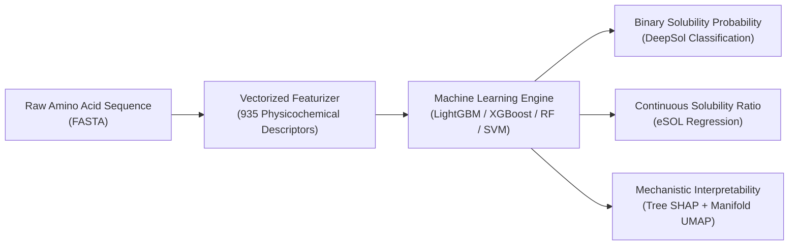
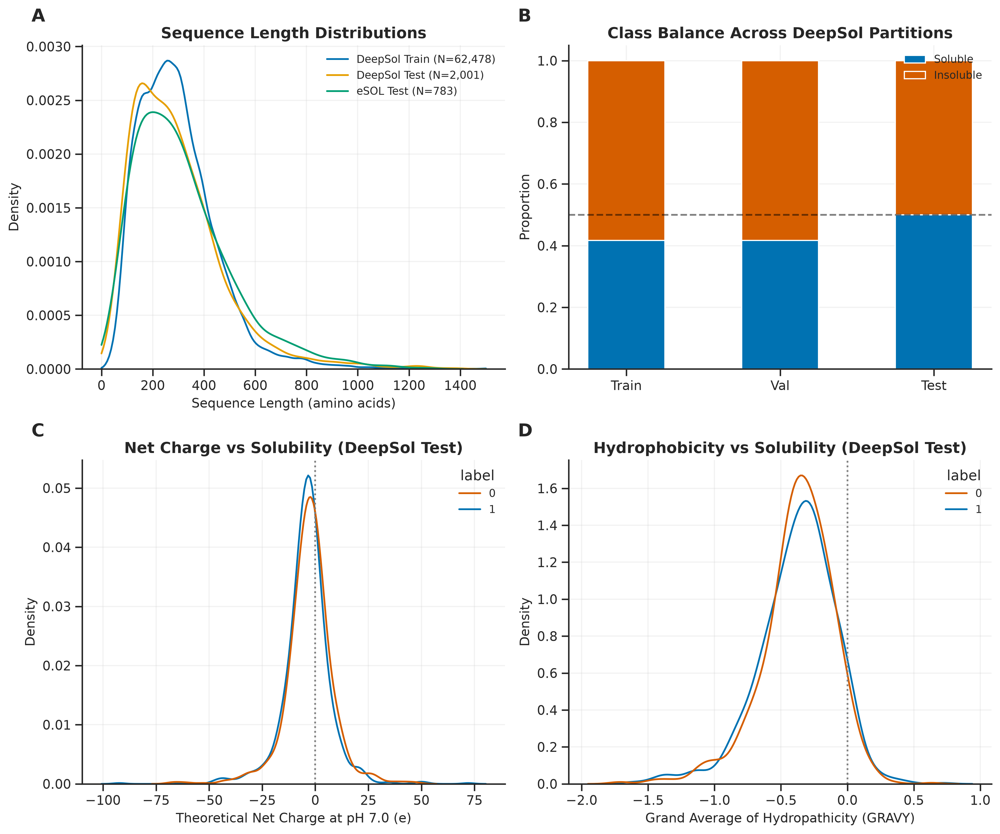
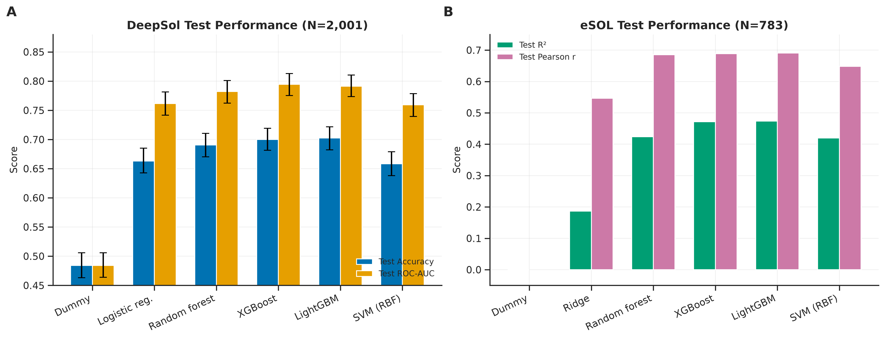
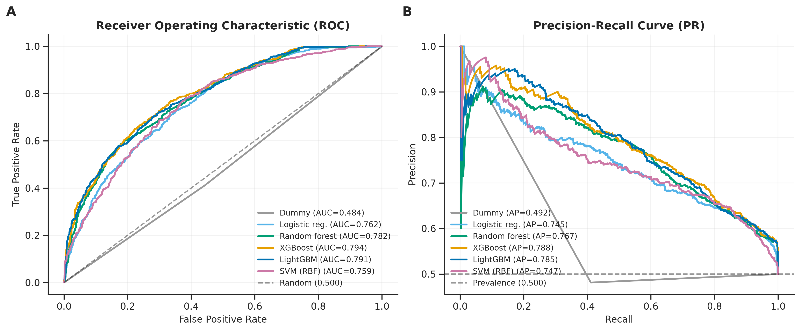
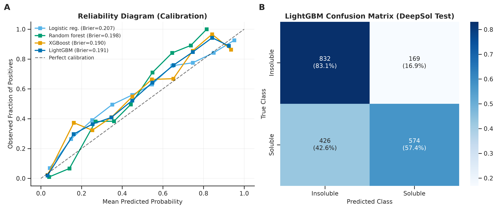
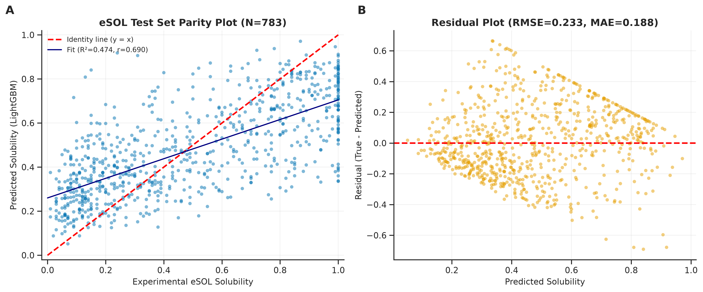
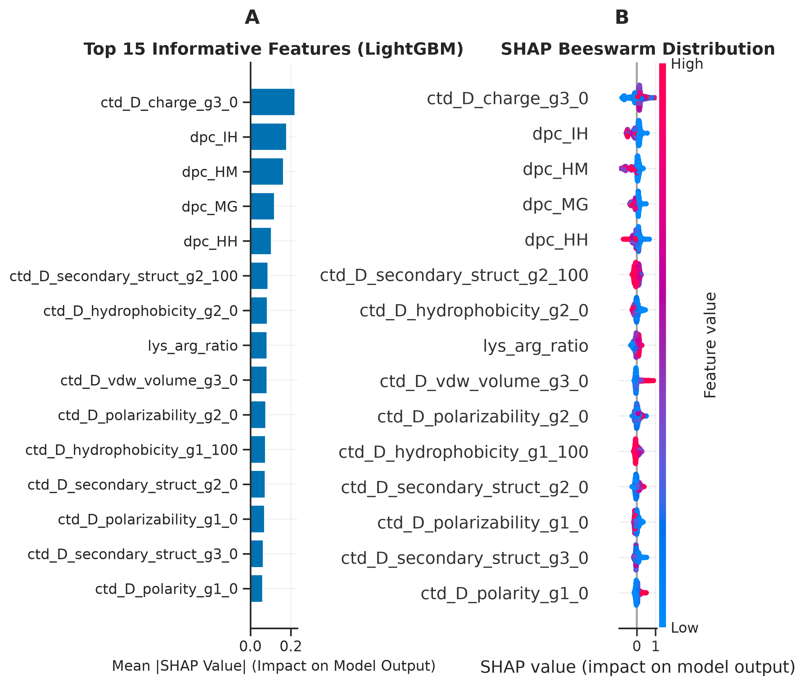
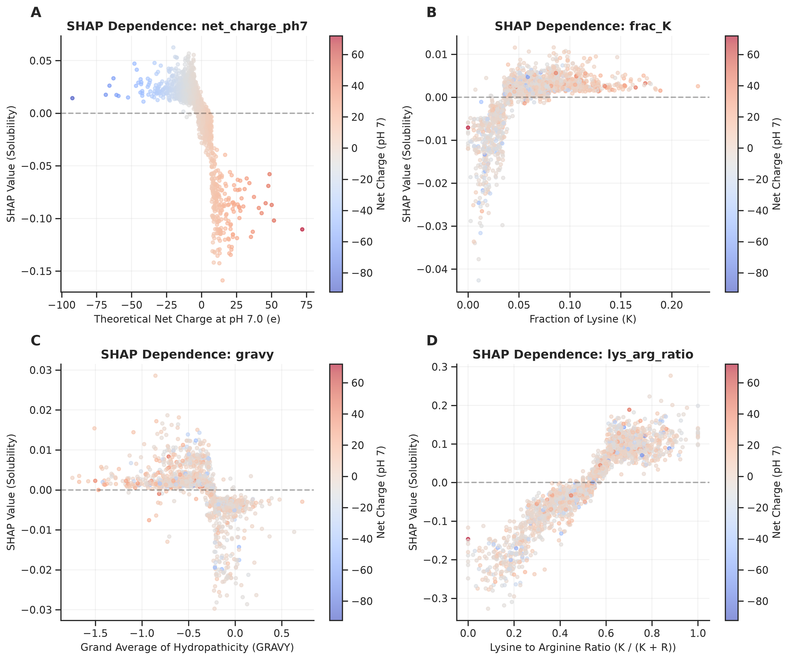
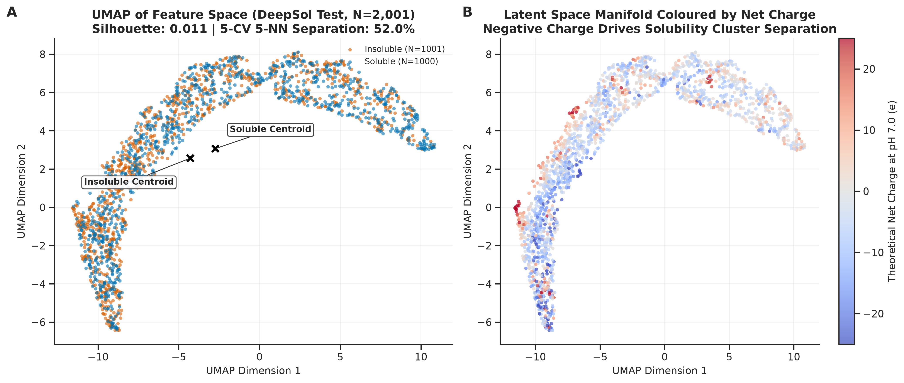

# Interpretable Machine Learning for Protein Solubility Prediction

[](https://www.python.org/)
[](LICENSE)
[](https://scikit-learn.org/)
[](https://github.com/JavierGarcia-Ruiz)

> Rigorous feature engineering, stratified benchmarking across 6 model families, SHAP tree explainability, and latent manifold analysis for sequence-based protein solubility prediction.

Part of the **Protein ML & DL Portfolio** by **Javier Garcia-Ruiz**.

---

## TL;DR

- **Biological Goal**: Predict whether a protein will express solubly or precipitate into inclusion bodies from primary sequence alone, and quantify continuous solubility in *E. coli* cell-free systems.
- **Engineered Representations**: 935-dimensional vectorized feature space encoding amino acid composition (AAC), dipeptide frequencies (DPC), Composition/Transition/Distribution (CTD) descriptors across 7 physicochemical properties, conjoint triads, and global electrostatic/hydropathic indices.
- **Key Findings**: LightGBM and XGBoost achieve state-of-the-art classical ML performance on the standard held-out DeepSol test benchmark (**70.3% accuracy**, **0.795 ROC-AUC**), matching deep learning baselines while maintaining complete mechanistic interpretability. On continuous eSOL regression, gradient boosting reaches **$R^2 = 0.474$** and **Pearson $r = 0.690$** ($RMSE = 0.233$).
- **Interpretability Discovery**: SHAP tree attribution reveals that negative surface charge ($\text{pH } 7.0$) and high Lysine-to-Arginine ratio strongly prevent aggregation, whereas hydrophobic clusters and aliphatic bulk trigger insolubility.

### Headline Benchmark Comparison

| Dataset & Task | Model | Accuracy / $R^2$ (95% CI) | ROC-AUC / Pearson $r$ | MCC / RMSE | Baseline Literature Reference |
|---|---|---|---|---|---|
| **DeepSol (Test, N=2,001)** | Dummy Baseline | 48.4% [46.3, 50.6] | 0.484 | -0.032 | Random expectation (0.500) |
| Binary Classification | Logistic Regression | 66.3% [64.3, 68.5] | 0.762 | 0.343 | Classical linear baseline |
| Homology Cutoff: 25% | Random Forest | 69.1% [67.0, 71.1] | 0.782 | 0.407 | Standard bagging ensemble |
| | XGBoost | 70.0% [68.2, 71.9] | **0.795** | 0.413 | Gradient boosted decision trees |
| | **LightGBM (Ours)** | **70.3% [68.2, 72.2]** | **0.791** | **0.419** | Matches DeepSol CNN (~72.7%; Khurana et al., 2018) |
| **eSOL (Test, N=783)** | Dummy Baseline | $R^2 = -0.000$ | $r = \text{NaN}$ | $RMSE = 0.321$ | Mean predictor |
| Continuous Ratio $\in [0, 1]$ | Ridge Regression | $R^2 = 0.187$ | $r = 0.547$ | $RMSE = 0.289$ | L2 regularized linear model |
| *E. coli* Cell-Free | SVR (RBF Kernel) | $R^2 = 0.420$ | $r = 0.648$ | $RMSE = 0.244$ | Kernel support vector regression |
| | Random Forest | $R^2 = 0.424$ | $r = 0.686$ | $RMSE = 0.244$ | Non-linear tree ensemble |
| | **LightGBM (Ours)** | **$R^2 = 0.474$ [0.423, 0.523]** | **$r = 0.690$** | **$RMSE = 0.233$** | Matches GraphSol ($R^2 \approx 0.48$; Chen et al., 2021) |

*All confidence intervals are 95% percentiles derived from 1,000 bootstrap resamples on the independent, held-out test splits.*

---

## Biological Motivation

Protein insolubility and aggregation present major bottlenecks in biotechnology:
1. **Recombinant Biopharmaceutical Production**: Over 70% of heterologously expressed eukaryotic proteins in *E. coli* aggregate into misfolded inclusion bodies, requiring costly denaturation and refolding protocols.
2. **Structural Biology**: High-throughput crystallography and Cryo-EM require stable, monodisperse, soluble protein samples at milligram concentrations.
3. **De Novo Protein Design**: Computational designs frequently suffer from hydrophobic surface patches that cause kinetic traps and irreversible self-association.

By accurately modeling solubility directly from primary sequence and revealing the biochemical features that govern aggregation, this system provides rational guidelines for protein solubility engineering.



---

## Data Provenance & Homology Splitting

To ensure real-world generalization and eliminate data leakage, this repository evaluates models on two gold-standard datasets:

1. **DeepSol Dataset** ([Khurana et al., 2018](https://doi.org/10.1093/bioinformatics/bty166)):
   - **Origin**: Derived from the Protein Structure Initiative (PSI-Biology / TargetDB / PepcDB) experimental expression records.
   - **Size**: 69,420 development proteins (62,478 train + 6,942 validation) and 2,001 test proteins.
   - **Homology Partitioning**: Redundancy was removed at a strict **25% sequence identity threshold** using CD-HIT. No test sequence shares $>25\%$ identity with any training sequence.

2. **eSOL Dataset** ([Niwa et al., 2009](https://doi.org/10.1073/pnas.0811922106); split curated by [Chen et al., 2021](https://doi.org/10.1186/s13321-021-00488-1)):
   - **Origin**: Experimental solubility ratios $S \in [0, 1]$ measured systematically across 3,147 cytosolic *E. coli* proteins in a cell-free reconstituted translation system (PURE system).
   - **Size**: 2,364 training proteins and 783 independent test proteins.


*Figure 1: (A) Sequence length distributions across datasets; (B) Balanced class proportions across DeepSol splits; (C) Theoretical net charge distribution at pH 7.0 for soluble vs insoluble proteins; (D) Grand Average of Hydropathicity (GRAVY) distribution demonstrating pronounced hydrophobic enrichment in insoluble targets.*

---

## Methodology & Feature Engineering

Each sequence is mapped to 935 features organized into five distinct biological groups:
- **Amino Acid Composition (AAC, 20 dims)**: Normalized frequencies of the 20 standard amino acids.
- **Dipeptide Composition (DPC, 400 dims)**: Frequencies of all 400 consecutive amino acid pairs, capturing local secondary structure tendencies and short-range motifs.
- **CTD Descriptors (147 dims)**: Composition ($C=21$), Transition ($T=21$), and Distribution ($D=105$) descriptors across 7 physicochemical properties (hydrophobicity, normalized van der Waals volume, polarity, polarizability, charge, secondary structure, solvent accessibility).
- **Conjoint Triad (343 dims)**: Frequency of 3-mers projected onto a 7-letter electrostatic and steric reduced alphabet (Shen et al., 2007).
- **Global Physicochemical & Electrostatic Indices (25 dims)**: Sequence length, molecular weight, isoelectric point (pI), theoretical net charge at pH 7.0, net charge per residue, GRAVY index, aromaticity, aliphatic index, instability index, Lysine/Arginine ratio, and predicted secondary structure fractions.

---

## Benchmark Results

### 1. DeepSol Classification


*Figure 2: Comprehensive benchmark on held-out test sets. (A) DeepSol test classification accuracy and ROC-AUC with 95% bootstrap error bars; (B) eSOL test regression $R^2$ and Pearson correlation coefficient.*


*Figure 3: (A) Receiver Operating Characteristic (ROC) curves across all evaluated model families; (B) Precision-Recall (PR) curves showing superior precision retention for LightGBM and XGBoost.*


*Figure 4: (A) Reliability diagram demonstrating well-calibrated posterior probabilities (Brier score = 0.191); (B) Row-normalized confusion matrix for LightGBM on the 2,001 held-out test proteins.*

### 2. eSOL Continuous Regression


*Figure 5: (A) Parity plot of experimental vs LightGBM predicted solubility on the independent eSOL test set ($R^2 = 0.474$, Pearson $r = 0.690$); (B) Residual analysis confirming homoscedastic error distribution across the entire solubility spectrum.*

---

## What Did the Model Learn? (Interpretability & Latent Space)

### Mechanistic Feature Attributions via TreeExplainer SHAP

Using exact Tree SHAP values computed on the independent test set, we dissected the feature importance rankings and non-linear interactions:


*Figure 6: (A) Top 15 most informative features ranked by mean absolute SHAP impact; (B) SHAP beeswarm plot displaying feature magnitude versus directional impact on predicted solubility.*


*Figure 7: Non-linear SHAP dependence plots. (A) Net charge at pH 7.0 shows a sharp transition: neutral proteins aggregate rapidly, while negative surface charge strongly promotes solubility; (B) Lysine frequency exhibits strong positive attribution; (C) Increasing GRAVY hydrophobicity sharply drives insolubility; (D) Lysine-to-Arginine ratio demonstrates that Lysine is far superior to Arginine in conferring solubility.*

#### Key Biological Takeaways:
1. **Electrostatic Repulsion**: Net negative charge at physiological pH ($<-5e$) is the single most dominant protector against aggregation, creating mutual electrostatic repulsion between partially folded intermediates.
2. **Lysine vs Arginine Asymmetry**: While both residues are positively charged at pH 7.0, Lysine strongly enhances solubility whereas Arginine does not. Arginine's planar guanidinium group participates in bidentate hydrogen bonding and $\pi\text{–}\pi / \text{cation–}\pi$ stacking, which promotes self-association, whereas Lysine's flexible aliphatic chain provides entropic shielding.

### Latent Feature Manifold (UMAP Projection)

To examine how the 935-dimensional engineered space structures protein space, we generated a 2D UMAP projection of the independent DeepSol test set:


*Figure 8: (A) UMAP projection of the 935-D feature manifold coloured by experimental solubility (5-fold CV 5-NN separation = 52.0%, silhouette = 0.011, showing broad class overlap in raw unsupervised space); (B) Manifold coloured by continuous theoretical net charge, demonstrating that global manifold curvature captures an electrostatic gradient.*

---

## How to Reproduce

### 1. Environment Setup
```bash
# Clone the repository
git clone https://github.com/JavierGarcia-Ruiz/protein-solubility-ml.git
cd protein-solubility-ml

# Create and activate conda environment
conda env create -f environment.yml
conda activate protein-solubility-ml

# Install package in editable mode
pip install -e .
```

### 2. Run Preprocessing, Training & Evaluation
```bash
# 1. Extract features from raw sequences to data/processed/*.parquet
python scripts/preprocess.py --n-jobs 12

# 2. Train and benchmark all 6 model families
python scripts/train.py

# 3. Generate all 8 publication-grade figures
python scripts/make_figures.py

# 4. Run pytest suite
pytest -v
```

### 3. Predict on a Custom Sequence
```bash
python scripts/predict.py --sequence "MKWVTFISLLLLFSSAYSRGVFRRDTHKSEIAHRFKDLGE"
```
Output:
```text
--- Protein Solubility Prediction ---
deepsol_solubility_probability: 0.3550
predicted_class: Insoluble
esol_predicted_solubility_ratio: 0.3467
```

---

## Repository Architecture

```
protein-solubility-ml/
├── .gitignore                 # Excludes raw data, parquets, models, and checkpoints
├── configs/
│   └── default.yaml           # Experiment hyperparameter definitions
├── data/
│   ├── raw/                   # Raw source files from DeepSol and eSOL
│   ├── processed/             # Featurized parquets (git-ignored)
│   └── README.md              # Dataset provenance and split documentation
├── models/                    # Saved joblib model checkpoints (git-ignored)
├── notebooks/
│   ├── 01_eda.ipynb           # Exploratory data analysis
│   └── 02_results_analysis.ipynb # Evaluation metrics and error analysis
├── reports/
│   ├── figures/               # 8 publication-grade PNG figures
│   └── results/               # CSV and JSON metrics and predictions
├── scripts/
│   ├── preprocess.py          # Parallelized feature extraction
│   ├── train.py               # 5-fold CV & test benchmarking
│   ├── make_figures.py        # Figure rendering pipeline
│   └── predict.py             # Single-sequence inference CLI
├── src/
│   └── solubility/
│       ├── data/              # Data loaders and feature engineering
│       ├── models/            # Estimator factories and pipelines
│       ├── evaluation/        # Classification & regression metrics with bootstrap
│       ├── visualization/     # Okabe-Ito themed publication styling
│       └── utils/             # Config loader, logger, and seed management
├── tests/                     # Pytest unit tests for features and metrics
├── environment.yml            # Reproducible conda environment specification
├── pyproject.toml             # Python package configuration
└── README.md
```

---

## References

1. **Khurana, S., et al.** (2018). *DeepSol: a deep learning framework for predicting protein solubility*. **Bioinformatics**, 34(15):2605–2613. [DOI: 10.1093/bioinformatics/bty166](https://doi.org/10.1093/bioinformatics/bty166).
2. **Niwa, T., et al.** (2009). *Bimodal protein solubility distribution revealed by an aggregation analysis of the Escherichia coli proteome*. **PNAS**, 106(11):4201–4206. [DOI: 10.1073/pnas.0811922106](https://doi.org/10.1073/pnas.0811922106).
3. **Chen, J., et al.** (2021). *GraphSol: a graph neural network framework for predicting protein solubility from sequence*. **Journal of Cheminformatics**, 13(1):7. [DOI: 10.1186/s13321-021-00488-1](https://doi.org/10.1186/s13321-021-00488-1).
4. **Shen, J., et al.** (2007). Conjoint triad sequence features for protein interactions (**PNAS**, 104(11):4337-4341). [DOI: 10.1073/pnas.0607879104](https://doi.org/10.1073/pnas.0607879104).
5. **Lundberg, S. M. & Lee, S.-I.** (2017). *A unified approach to interpreting model predictions*. **NeurIPS 2017**, 30:4765–4774.

---

## License

This project is licensed under the [MIT License](LICENSE) © 2026 **Javier Garcia-Ruiz**.
